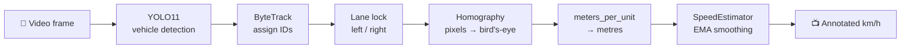

<div align="center">

# 🚦 Traffic Speed Monitor

**Real-time vehicle speed estimation from a fixed highway camera**
*YOLO11 detection · ByteTrack tracking · per-lane homography calibration*


</div>

---

## ✨ Features

- 🎯 **Vehicle detection**: YOLO11 filtered to cars, motorcycles, buses and trucks
- 🔗 **Persistent tracking**: ByteTrack keeps a stable ID per vehicle across frames
- 🛣️ **Per-lane calibration**: separate perspective and scale for each carriageway
- 📐 **Bird's-eye conversion**: pixel movement is mapped to real-world metres via homography
- 📉 **Smoothed speeds**: EMA filtering plus jitter, outlier and ID-switch rejection
- 🎨 **Live overlay**: ID, class and km/h drawn on every vehicle

## 🧠 How it works



1. Each vehicle's **bottom-centre point** is tracked frame to frame.
2. That point is warped into a top-down view using the lane's calibrated road quad.
3. Distance travelled in the top-down view × `meters_per_unit` gives metres.
4. Metres ÷ time (from the video FPS) gives speed, which is smoothed with an EMA.

## 📁 Project structure

```
traffic-speed-monitor/
├── app.py                    # main pipeline, run this to watch it live
├── calibrate_perspective.py  # step 1: click the road quad per lane
├── calibrate_scale.py        # step 2: click a car's length per lane → real-world scale
├── config.yaml               # all settings + calibration output
├── requirements.txt
├── assets/                   # README images
├── utils/
│   ├── perspective.py        # PerspectiveTransformer (pixel ↔ bird's-eye)
│   └── speed.py              # SpeedEstimator (bird's-eye movement → smoothed km/h)
├── videos/                   # put your source video here
└── weights/                  # put yolo11s.pt (or your model) here
```

## 🚀 Quick start

```bash
# 1. clone & enter
git clone https://github.com/<your-username>/traffic-speed-monitor.git
cd traffic-speed-monitor

# 2. create a virtual environment
python -m venv traffic_env
traffic_env\Scripts\activate        # Windows
# source traffic_env/bin/activate   # Linux / macOS

# 3. install dependencies
pip install -r requirements.txt
```

Then:

1. Put your video in `videos/` and your YOLO weights in `weights/`.
2. Set `video.path` in `config.yaml` to your video's filename.
3. Run the two calibration steps below, then start the app.

## 🎯 Calibration

> Do this **once per camera angle**. `app.py` refuses to start if either lane is missing calibration.

### Step 1: Road quad (perspective)

```bash
python calibrate_perspective.py
```

Click 4 points per lane **(top-left → top-right → bottom-right → bottom-left)** following the road. A bird's-eye preview appears after each lane. Lane markings and road edges should look roughly **vertical and parallel**, and cars shouldn't look absurdly stretched.

This writes `source_points` into `config.yaml`.

### Step 2: Real-world scale

```bash
python calibrate_scale.py --lane left_lane
python calibrate_scale.py --lane right_lane
```

Click the **front then rear** of a car (or any two points a known distance apart) on a few different vehicles. This writes `meters_per_unit` into `config.yaml` for that lane.

> 💡 Run it once **per lane**. The two carriageways almost never share the same scale because their road quads cover different physical distances.

## ▶️ Run

```bash
python app.py
```

## ⚙️ Configuration

Speed-smoothing settings live under `speed_estimation` in `config.yaml`:

| Parameter | Default | What it does |
|---|---|---|
| `ema_alpha` | `0.3` | Higher = reacts faster to real changes, but is jumpier |
| `min_distance_m` | `0.3` | Movement below this is treated as detector jitter, not real motion |
| `max_plausible_kmph` | `180` | Single-frame readings above this are rejected as noise or ID switches |
| `max_frame_gap` | `15` | If a track was lost longer than this many frames, the jump on reappearance is not trusted |

## 📝 Notes

- `output_width` / `output_height` are just the **warp canvas resolution**, not real-world units. Don't change them to "fix" scale; that's what `meters_per_unit` is for.
- Set `DEBUG = True` at the top of `app.py` to print per-vehicle pixel/world coordinates and speed every frame.
- Accuracy depends heavily on calibration quality. Use a clear, straight road section and a vehicle of known length.

## 🛠️ Built with

[Ultralytics YOLO11](https://docs.ultralytics.com/) · [Supervision](https://supervision.roboflow.com/) · [OpenCV](https://opencv.org/) · [NumPy](https://numpy.org/) · [PyYAML](https://pyyaml.org/)

---

<div align="center">

⭐ If you found this useful, consider starring the repo!

</div>
